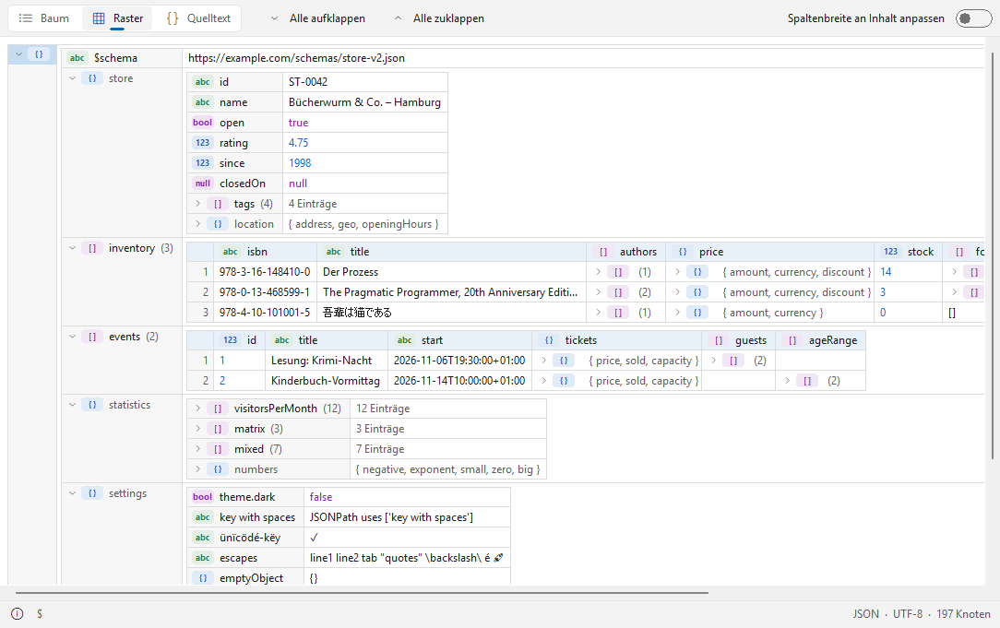

# TreeView

[English](README.md) | **Deutsch**

Ein XML-, JSON- und YAML-Betrachter (Lister-Plugin) für den [Total Commander](https://www.ghisler.com), 32 und 64 Bit.
F3 auf einer Datendatei zeigt sie in drei Ansichten: als Baum (wie XML Notepad), als verschachteltes Raster (wie XMLSpy) und als formatierten, farbigen Quelltext.
Große Dateien öffnen sich schnell, fehlerhafte Dateien zeigen trotzdem alles bis zum Fehler. Nativ, keine Laufzeitumgebung, nichts zu installieren außer dem Plugin.

## Unterstützte Dateien

- **XML** und seine Dialekte: `.xml`, `.xsd`, `.xsl`, `.xslt`, `.svg`, `.config`, `.csproj`, `.vbproj`, `.vcxproj`, `.fsproj`, `.props`, `.targets`, `.nuspec`, `.resx`, `.plist`, `.rss`, `.atom`, `.wsdl`, `.kml`, `.gpx`, `.xaml`, `.manifest`, `.xlf`, `.xliff`, `.fb2`, `.rdf`, `.owl`, `.opml`, `.gml`, `.graphml`, `.bpmn`, `.wxs`, `.wxi`, `.wxl`, `.appxmanifest`, `.vsixmanifest`, `.vstemplate`, `.pubxml`, `.runsettings`, `.ruleset`, `.slnx`, `.user`, `.rdl`, `.rdlc`, `.dtsx`, `.tmx`, `.xbrl`, `.xmi`, `.dae`, `.xib`, `.storyboard`, `.musicxml`, `.opf`, `.ncx`, `.xspf`
- **JSON:** `.json`, `.jsonc`, `.json5`, `.geojson`, `.topojson`, `.webmanifest`, `.har`, `.arb` – tolerant: Kommentare, Kommas am Ende, einfache Anführungszeichen
- **JSON Lines:** `.jsonl`, `.ndjson`
- **YAML:** `.yaml`, `.yml` – Anker und Aliase, Merge-Keys, Tags, mehrere Dokumente in einer Datei
- **TOML:** `.toml`
- **Windows-Registrierungsexporte:** `.reg`

## Funktionen

- ***Baum***: Namen und Werte nebeneinander, Typ-Kennzeichen (Text, Zahl, Bool, Null, Objekt, Array), auf Wunsch mit Anzahl der Unterknoten
- ***Raster***: verschachtelte Tabellen; Arrays gleichartiger Objekte werden zu einer Tabelle mit einer Spalte pro Schlüssel; Spaltenbreiten lassen sich an den Inhalt anpassen
- ***Quelltext***: formatiert und farbig; der ausgewählte Knoten bleibt beim Wechsel der Ansicht ausgewählt
- **Werte direkt bearbeiten**: Doppelklick auf einen Wert, Strg+E oder F4 (Text, Zahlen, Booleans, XML-Attribute und Elementtext) – nur diese Stelle der Datei wird geändert, Kommentare und Formatierung bleiben erhalten (nicht bei `.reg`-Dateien)
- Wert, Name, Pfad (XPath bei XML, JSONPath bei JSON) oder einen ganzen Knoten als XML/JSON/YAML über das Kontextmenü kopieren
- Pfad des ausgewählten Knotens in der Statusleiste, dazu Format, Kodierung und Anzahl der Knoten
- Syntaxfehler werden mit Zeilennummer gemeldet; alles bis zum Fehler wird trotzdem angezeigt
- Wählbare Schriftart; helles und dunkles Design (automatisch wie Windows oder fest) im Windows-11-Look
- Kodierungen: UTF-8, UTF-16 (mit oder ohne BOM), Windows-1252 und die Kodierungsangabe in XML
- Oberfläche auf Deutsch und Englisch (richtet sich nach der Windows-Sprache)

## Download und Installation

1. **`TreeView.zip`** aus der [neuesten Version](https://github.com/naderi/tc-treeview/releases/latest) herunterladen.
2. Die ZIP-Datei im Total Commander öffnen (Enter auf der Datei) und die Frage nach der Installation des Plugins bestätigen.

Die Einstellungen liegen in `TreeView.ini` neben dem Plugin.

## Tasten

| Taste | Aktion |
|---|---|
| Strg+1 / Strg+2 / Strg+3 | *Baum* / *Raster* / *Quelltext* |
| Strg+Plus / Strg+Minus | *Alle aufklappen* / *Alle zuklappen* |
| * | *Unterknoten aufklappen* |
| Strg+E / F4 / Doppelklick | *Wert bearbeiten* |
| Strg+C | *Wert kopieren* |
| Strg+Umschalt+C | *XPath kopieren* / *JSONPath kopieren* |
| F7 | Suchen (Suche des Total Commander) |
| F1 | Info |

Weitere Optionen – *Design*, *Schriftart…*, *Spaltenbreiten zurücksetzen* – stehen im Kontextmenü (Rechtsklick).

## Lizenz

Freeware – kostenlos nutzbar, aber **nicht verkäuflich**. Siehe [LICENSE](LICENSE).

## Unterstützung

Wenn TreeView dir Zeit spart, kannst du die Entwicklung auf Ko‑fi unterstützen. ☕

---

© 2026 [Ali Naderi](https://github.com/naderi) · [digitalent.dev](https://digitalent.dev/de/)
