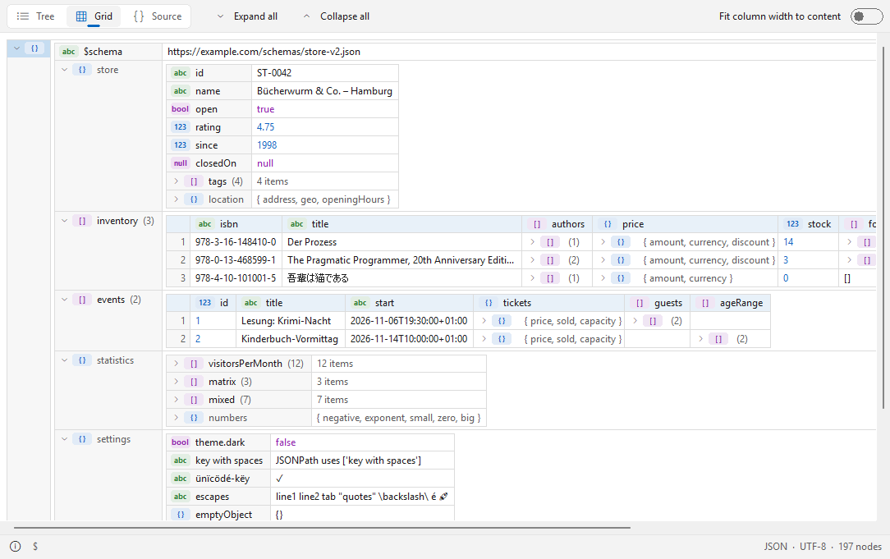

# TreeView

**English** | [Deutsch](README.de.md)

An XML, JSON and YAML viewer (Lister plugin) for [Total Commander](https://www.ghisler.com), 32 and 64 bit.
Press F3 on a data file and see it in three views: as a tree (like XML Notepad), as a nested grid (like XMLSpy) and as formatted, coloured source code.
Large files open quickly, broken files still show everything up to the error. Native, no runtime, nothing to install besides the plugin.

## Supported files

- **XML** and its dialects: `.xml`, `.xsd`, `.xsl`, `.xslt`, `.svg`, `.config`, `.csproj`, `.vbproj`, `.vcxproj`, `.fsproj`, `.props`, `.targets`, `.nuspec`, `.resx`, `.plist`, `.rss`, `.atom`, `.wsdl`, `.kml`, `.gpx`, `.xaml`, `.manifest`, `.xlf`, `.xliff`, `.fb2`, `.rdf`, `.owl`, `.opml`, `.gml`, `.graphml`, `.bpmn`, `.wxs`, `.wxi`, `.wxl`, `.appxmanifest`, `.vsixmanifest`, `.vstemplate`, `.pubxml`, `.runsettings`, `.ruleset`, `.slnx`, `.user`, `.rdl`, `.rdlc`, `.dtsx`, `.tmx`, `.xbrl`, `.xmi`, `.dae`, `.xib`, `.storyboard`, `.musicxml`, `.opf`, `.ncx`, `.xspf`
- **JSON:** `.json`, `.jsonc`, `.json5`, `.geojson`, `.topojson`, `.webmanifest`, `.har`, `.arb` – tolerant: comments, trailing commas, single quotes
- **JSON Lines:** `.jsonl`, `.ndjson`
- **YAML:** `.yaml`, `.yml` – anchors and aliases, merge keys, tags, several documents in one file
- **TOML:** `.toml`
- **Windows registry exports:** `.reg`

## Features

- ***Tree***: names and values side by side, type badges (text, number, bool, null, object, array), optional count of child nodes
- ***Grid***: nested tables; arrays of similar objects become one table with a column per key; column widths can be fitted to the content
- ***Source***: pretty-printed, syntax-coloured source; the selected node stays selected when you switch views
- Copy value, name, path (XPath for XML, JSONPath for JSON) or a whole node as XML/JSON/YAML from the context menu
- Path of the selected node in the status bar, plus format, encoding and node count
- Syntax errors are reported with line number; everything read up to the error is still shown
- Selectable font; light and dark design (automatic like Windows, or fixed) in the Windows 11 look
- Text encodings: UTF-8, UTF-16 (with or without BOM), Windows-1252 and the XML encoding declaration
- English and German user interface (follows the Windows language)

## Download and installation

1. Download **`TreeView.zip`** from the [latest release](https://github.com/naderi/treeview/releases/latest).
2. Open the ZIP in Total Commander (Enter on the file) and confirm the question whether to install the plugin.

Settings are stored in `TreeView.ini` next to the plugin.

## Keys

| Key | Action |
|---|---|
| Ctrl+1 / Ctrl+2 / Ctrl+3 | *Tree* / *Grid* / *Source* |
| Ctrl+plus / Ctrl+minus | *Expand all* / *Collapse all* |
| * | *Expand subtree* |
| Ctrl+C | *Copy value* |
| Ctrl+Shift+C | Copy XPath / JSONPath |
| F7 | Find (Total Commander's search) |
| F1 | About |

More options – *Theme*, *Font…*, *Reset column widths* – are in the context menu (right click).

## License

Freeware – free to use, but **not for sale**. See [LICENSE](LICENSE).

## Support

If TreeView saves you time, you can support its development on Ko‑fi. ☕

---

© 2026 [Ali Naderi](https://github.com/naderi) · [digitalent.dev](https://digitalent.dev/en/)
