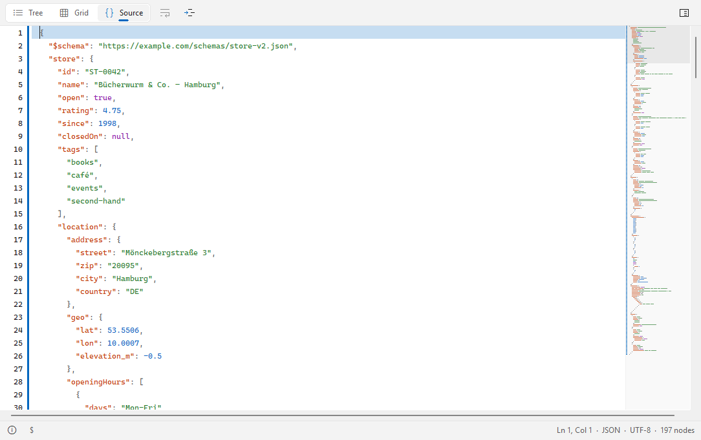

# TreeView

**English** | [Deutsch](README.de.md)

An XML, JSON and YAML viewer (Lister plugin) for [Total Commander](https://www.ghisler.com), 32 and 64 bit.
Press F3 on a data file and see it in three views: as a tree (like XML Notepad), as a nested grid (like XMLSpy) and as formatted, coloured source code.
Large files open quickly, broken files still show everything up to the error. Native, no runtime, nothing to install besides the plugin.

## Supported files

- **XML** and its dialects: `.xml`, `.xsd`, `.xsl`, `.xslt`, `.svg`, `.config`, `.csproj`, `.vbproj`, `.vcxproj`, `.fsproj`, `.props`, `.targets`, `.nuspec`, `.resx`, `.plist`, `.rss`, `.atom`, `.wsdl`, `.kml`, `.gpx`, `.xaml`, `.manifest`, `.xlf`, `.xliff`, `.fb2`, `.rdf`, `.owl`, `.opml`, `.gml`, `.graphml`, `.bpmn`, `.wxs`, `.wxi`, `.wxl`, `.appxmanifest`, `.vsixmanifest`, `.vstemplate`, `.pubxml`, `.runsettings`, `.ruleset`, `.slnx`, `.user`, `.rdl`, `.rdlc`, `.dtsx`, `.tmx`, `.xbrl`, `.xmi`, `.dae`, `.xib`, `.storyboard`, `.musicxml`, `.opf`, `.ncx`, `.xspf`
- **JSON:** `.json`, `.jsonc`, `.json5`, `.geojson`, `.topojson`, `.webmanifest`, `.har`, `.arb` – tolerant: comments, trailing commas, single quotes
- **JSON Lines:** `.jsonl`, `.ndjson`
- **YAML:** `.yaml`, `.yml` – anchors and aliases, merge keys, tags, several documents in one file
- **TOML:** `.toml`
- **Windows registry exports:** `.reg`

## Features

- ***Tree***: names and values side by side, type badges (text, number, bool, null, object, array), optional count of child nodes
- ***Grid***: nested tables; arrays of similar objects become one table with a column per key; column widths can be fitted to the content
- ***Source***: pretty-printed, syntax-coloured source; the selected node stays selected when you switch views
- **Select and copy text in the source view** like in a text viewer: drag with the mouse, double-click selects a word, Shift+click extends, Ctrl+A selects all, Ctrl+C or Ctrl+Insert copies. Without a selection Ctrl+C copies the value of the selected node
- **Text cursor** in the source view (context menu > *Text cursor*, `Cursor=0` in `TreeView.ini`): the arrow keys move it, Shift selects, Ctrl+arrows jump by word, Home/End and Ctrl+Home/End as in an editor. Only the cursor line is highlighted; the status bar shows line, column and the size of the selection (characters and lines)
- **Minimap** in the source view: a colored overview of the whole text at the right edge; click or drag it to scroll. Switch it with the icon at the right end of the toolbar (same icon as in [Synta](https://digitalent.dev/en/projects/synta/)), the context menu or `Minimap=0` in `TreeView.ini`
- **Word wrap** and **Show formatted** as icon buttons in the toolbar of the source view (same icons as in [Synta](https://digitalent.dev/en/projects/synta/)): *Word wrap* (key W, `Wrap=1` in `TreeView.ini`) cuts long lines at the window width; *Show formatted* (Ctrl+Shift+B, `Formatted=0` in `TreeView.ini`) shows XML and JSON re-indented or exactly as written in the file, e.g. minified JSON
- **Edit values in place**: double-click a value (in the source view a double click selects a word), Ctrl+E or F4 (text, numbers, booleans, XML attributes and element text) – only that part of the file is rewritten, comments and formatting stay (not for `.reg` files). Changes are written only when you save with Ctrl+S; closing a modified file asks first
- **Search field** (optional, off by default): *Search field in the toolbar* in the context menu, or `Search=1` in `TreeView.ini` (`Search=2` shows only a search button that opens the field). Enter = next match, Shift+Enter = previous, Esc = back to the view; all matches are highlighted and the current one stands out. The `.*` button searches with a regular expression. In the source view the matches are stepped through one by one, even several in a line. Ctrl+Shift+F jumps to the field (`SearchKey=F` makes it Ctrl+F, empty = no shortcut)
- **Color schemes**: Ayu, GitHub, Solarized, One, Catppuccin, Gruvbox, Tokyo Night, Rosé Pine and Visual Studio, each light and dark (context menu > *Color scheme*, separately for light and dark design); *Default* keeps the original colors. They are VS Code color themes, so you can add your own `*.json` files to the `Themes` folder next to the plugin
- Ctrl+E / F4 on an element or container without a value of its own edits the first value inside it
- **Always open** (context menu): *Collapsed* (default) or *Expanded* – whether files open fully expanded; stored as `Expanded=0` / `Expanded=1` in `TreeView.ini`. *Expand all* / *Collapse all* only act on the open file
- Copy value, name, path (XPath for XML, JSONPath for JSON) or a whole node as XML/JSON/YAML from the context menu
- Path of the selected node in the status bar, plus format, encoding and node count
- Syntax errors are reported with line number; everything read up to the error is still shown
- Selectable font; light and dark design (automatic like Windows, like Total Commander, or fixed) in the Windows 11 look
- Text encodings: UTF-8, UTF-16 (with or without BOM), Windows-1252 and the XML encoding declaration
- English and German user interface (follows the Windows language)

## Download and installation

1. Download **`TreeView.zip`** from the [latest release](https://github.com/naderi/tc-treeview/releases/latest).
2. Open the ZIP in Total Commander (Enter on the file) and confirm the question whether to install the plugin.

Settings are stored in `TreeView.ini` next to the plugin.

## Keys

| Key | Action |
|---|---|
| Ctrl+1 / Ctrl+2 / Ctrl+3 | *Tree* / *Grid* / *Source* |
| Ctrl+Tab / Ctrl+Shift+Tab | Next / previous view |
| Ctrl+plus / Ctrl+minus | *Expand all* / *Collapse all* |
| * | Expand the subtree, or collapse it when it is already fully open |
| Ctrl+E / F4 / double-click | *Edit value* |
| W / Ctrl+Shift+B | Source view: *Word wrap* / *Show formatted* |
| Ctrl+A | Source view: select all |
| Ctrl+S | *Save changes* |
| Ctrl+C | *Copy value*, or the selected text in the source view |
| Ctrl+Shift+C | Copy XPath / JSONPath |
| Ctrl+Shift+F | Jump to the search field (if enabled) |
| F7 | Find (Total Commander's search) |
| F1 | About |

More options – *Theme*, *Color scheme*, *Buttons*, *Search field in the toolbar*, *Font…*, *Reset column widths* – are in the context menu (right click).

## Languages

TreeView speaks English, German, Spanish, French, Russian, Ukrainian, Chinese (Simplified), Hindi, Portuguese and Persian. It follows the Windows display language; to pick another one, use the right-click menu (*Interface language*) or set `Language=<name or code>` in `TreeView.ini` (for example `Persian` or `fa`; `auto` follows Windows, `tc` follows Total Commander's own language – also the entry *Like Total Commander*).

The texts are plain `.lng` files in the `Languages` folder. To add a language, copy `Languages\Template.lng`, translate the right-hand sides and save it under a new name – it appears in the language list.

Corrections and new translations from native speakers are very welcome – please send them as an [issue](https://github.com/naderi/tc-treeview/issues) on this repository.

## License

Freeware – free to use, but **not for sale**. See [LICENSE](LICENSE).

## Support

If TreeView saves you time, you can support its development on Ko‑fi. ☕

---

© 2026 [Ali Naderi](https://github.com/naderi) · [digitalent.dev](https://digitalent.dev/en/)
